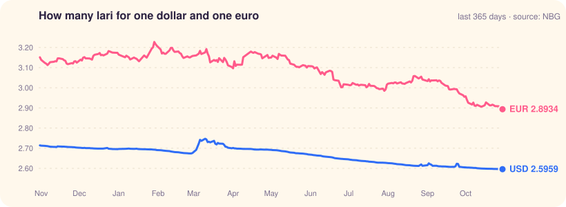
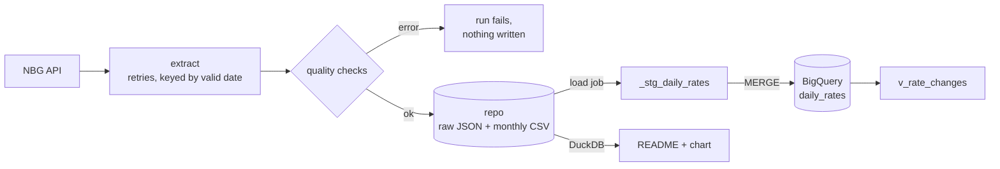

# NBG exchange rates, every business day

Every business day the National Bank of Georgia sets the official lari exchange
rates for the next day. This pipeline picks them up, checks them, keeps the
full history in this repo and loads it into BigQuery.

It runs on a schedule in GitHub Actions for a fixed 30 days
(13 Oct – 12 Nov 2026) and then switches itself off. The `data:` commits in
the history are those runs; the numbers below are rebuilt by every one of them.



<!-- report:start -->
**Rates valid for Friday, 23 October 2026**

| Currency | GEL | 1 day | 30 days |
|---|---:|---:|---:|
| 🇺🇸 1 USD | 2.5973 | ▼ 0.01% | ▼ 0.50% |
| 🇪🇺 1 EUR | 2.9137 | ▼ 0.09% | ▼ 2.66% |
| 🇬🇧 1 GBP | 3.4762 | ▼ 0.06% | ▼ 0.38% |
| 🇹🇷 1 TRY | 0.0523 | ▼ 0.19% | ▼ 2.24% |
| 🇷🇺 100 RUB | 3.1869 | ▲ 0.91% | ▲ 2.71% |
| 🇦🇿 1 AZN | 1.5281 | ▼ 0.01% | ▼ 0.49% |
| 🇦🇲 1,000 AMD | 7.1737 | ▲ 0.01% | ▼ 0.02% |

Biggest moves against the lari over 30 days: **IRR** -25.3%, **EGP** -7.0%, **RON** -4.1%.

<sub>514 rate dates · 21,902 rows · history from 01 Oct 2024 · 2 quality warnings in the last 30 days ([log](data/quality/checks.csv))</sub>
<!-- report:end -->

## How it works



Each run asks NBG for every day from a week before the last stored rate date
up to tomorrow. A set it hasn't seen is new; a set it has seen is compared with
the stored raw response, and if NBG changed it, it's stored again (git keeps the
old version, the `MERGE` updates the row). Nothing is written unless every check
passes, and a missed run catches up the next day.

| Layer | Where | What's in it |
|---|---|---|
| Raw | `data/raw/YYYY/MM/DD.json` | the API response exactly as NBG sent it |
| Clean | `data/rates/YYYY-MM.csv` | one row per currency per rate date |
| Checks | `data/quality/checks.csv` | one line per rate date: checks passed, warnings |
| Warehouse | BigQuery `nbg_fx.daily_rates` | same rows, `MERGE`d, plus `load_audit` |
| Analytics | BigQuery `nbg_fx.v_rate_changes` | 1-day and 30-day moves, z-score vs the previous 60 moves |

## What the data taught me

Found while backfilling two years (Oct 2024 – Oct 2026), most of them by the
pipeline stopping or warning:

1. **The date you ask for isn't the date you get.** NBG sets rates on business
   days for the next day, so every rate date in the data is a Tuesday to
   Saturday (100–103 of each). Asking for a Sunday or a Monday returns
   Saturday's set. Rows are keyed by the date NBG says they're valid for, so
   weekends never create duplicates.
2. **NBG re-issues sets after they take effect.** Rates valid 2025-10-04 carry
   a publish time of 2025-10-06; rates valid 2026-09-26, 2026-09-28. That's why
   each run re-checks the last week against the stored raw responses instead of
   only asking for new dates.
3. **A 96% drop that was real.** On 2026-01-27 the Iranian rial went from
   0.6415 to 0.0250 GEL per 10,000 IRR. The run stopped. The quantity hadn't
   changed and NBG's own diff (-0.6165) agreed, so NBG had switched which IRR
   rate it publishes. Accepted, with the reason, in
   [`accepted_moves.csv`](data/quality/accepted_moves.csv).
4. **A currency disappeared.** The Bulgarian lev is gone from 2026-01-01, when
   Bulgaria joined the euro. Flagged as a warning, not an error.
5. **Our numbers match NBG's exactly.** NBG publishes its own day-over-day
   change for every currency. The pipeline computes its own and compares:
   21,565 changes, 0 disagreements at the 4th decimal.
6. **Rates are quoted per 1 to 10,000 units** (AMD per 1,000, IRR per 10,000),
   so `rate` can't be compared across currencies. Every check and the view use
   `rate_per_unit`.
7. **Re-running changes nothing.** The daily run over a week it has already
   stored took 9.7 s and changed zero files.

## BigQuery, measured

- **First load:** 21,608 rows, staged and `MERGE`d in 19 s. Loading the same
  rows again: 0 inserted, 0 updated.
- **Size:** 2.1 MB in 25 monthly partitions, 0 duplicate keys.
- **Cost:** each daily `MERGE` bills 20 MiB, which is BigQuery's 10 MiB minimum
  for each of the two tables it touches, not the size of the data. That's about
  $0.0001 a run on demand, and the whole 30-day run is under 0.05% of the free
  1 TiB a month.
- **Two engines, one answer:** the BigQuery view and the DuckDB report are
  written separately and give the same 30-day moves (EUR -3.47%, GBP -2.26%,
  USD -0.37% on 13 Oct 2026).
- **The z-score is per currency.** USD/GEL usually moves by hundredths of a
  percent, so +1.05% on 2025-08-14 scores z = 57 against its previous 60 moves.
  It reversed (-0.93%) two days later.

## Quality checks

An error stops the run before anything is written, so the Actions run goes red
and a bad day never reaches the CSVs or BigQuery. A warning is logged and the
day is kept.

Some huge moves are real. When one is, a person reviews it and adds a line to
[`data/quality/accepted_moves.csv`](data/quality/accepted_moves.csv) with the
reason; that move then warns instead of failing, and git keeps who accepted it
and when.

| Check | Level |
|---|---|
| at least 40 currencies | error |
| USD, EUR, GBP, TRY, RUB present | error |
| no duplicate currency codes | error |
| rate and quantity positive | error |
| per-unit move vs previous set > 50% | error, unless reviewed and accepted |
| per-unit move vs previous set > 5% | warning |
| currency added or dropped | warning |
| our diff vs NBG's published diff | warning |
| set re-issued after the date it's valid for | warning |
| set changed since it was first stored | warning |

## Run it

```bash
python -m venv .venv && source .venv/bin/activate   # .venv\Scripts\activate on Windows
pip install -r requirements-dev.txt

python -m pipeline backfill --start 2026-09-01 --no-load   # fetch, check, store
python -m pipeline report                                   # rebuild README + chart
pytest -q
```

To load into BigQuery, create the cloud side with Terraform and point the
pipeline at the project:

```bash
cd infra && terraform init && terraform apply
GCP_PROJECT=<project> python -m pipeline load   # reload every stored row
```

`terraform apply` prints the three values the workflow needs; they go into the
repo's Actions variables (`GCP_PROJECT`, `GCP_WIF_PROVIDER`,
`GCP_SERVICE_ACCOUNT`). They're not secrets: none of them grants access on its
own.

## How it ends

`daily.yml` has a fixed end date. The first run after 12 Nov 2026 disables the
workflow, then `terraform destroy` removes the dataset, the service account and
the identity pool. The data stays here: the CSVs are the source of truth, and
`python -m pipeline load` rebuilds the warehouse from them at any time.

## Layout

```
pipeline/          extract, transform, quality, storage, warehouse, report, CLI
sql/bigquery/      table + view DDL, the MERGE
infra/             Terraform: dataset, loader service account, Workload Identity Federation
data/              raw responses, clean CSVs, quality log
docs/usd_eur.svg   chart, regenerated every run
.github/workflows/ daily.yml (the scheduled run), ci.yml (lint + tests)
```
